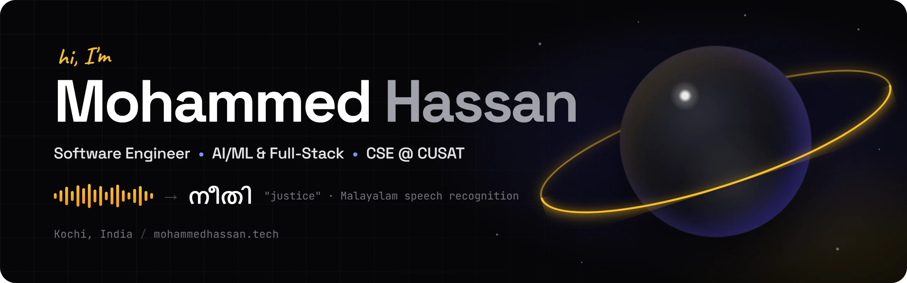
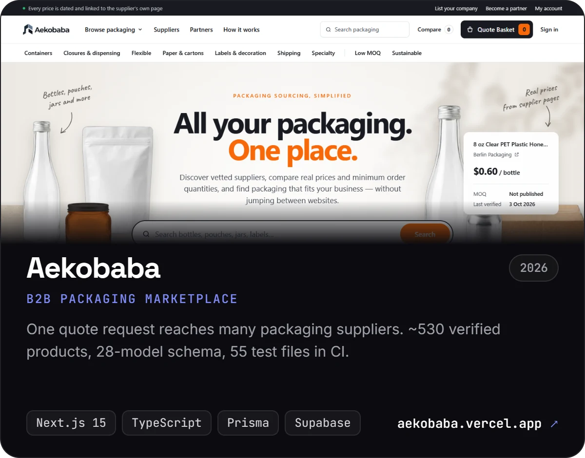
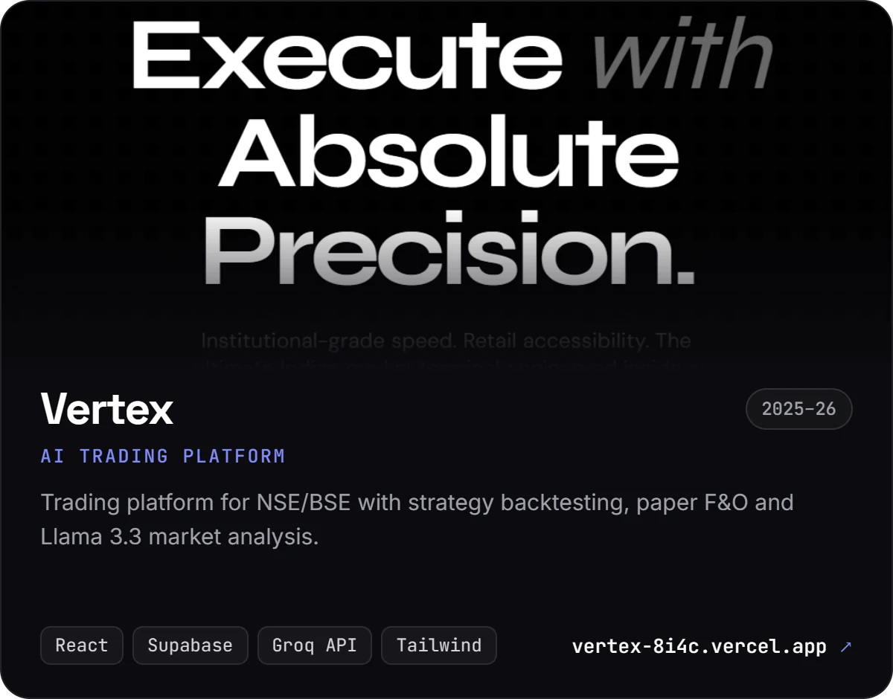
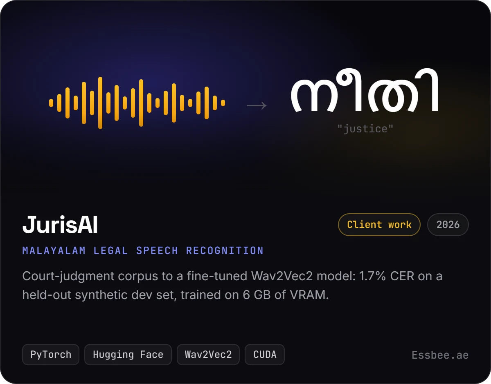
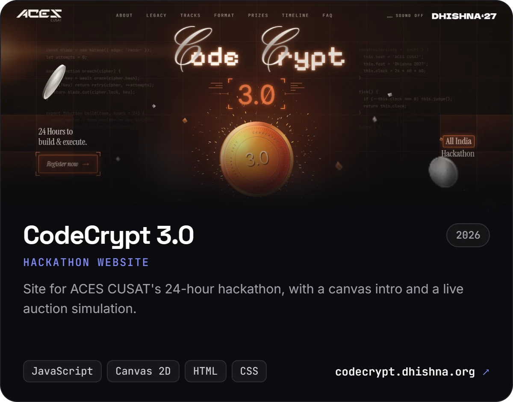
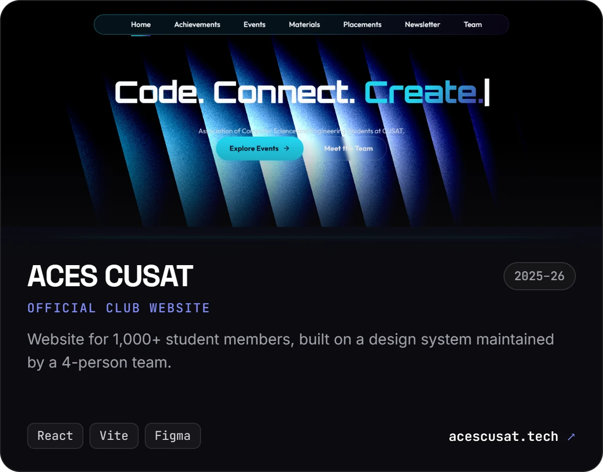
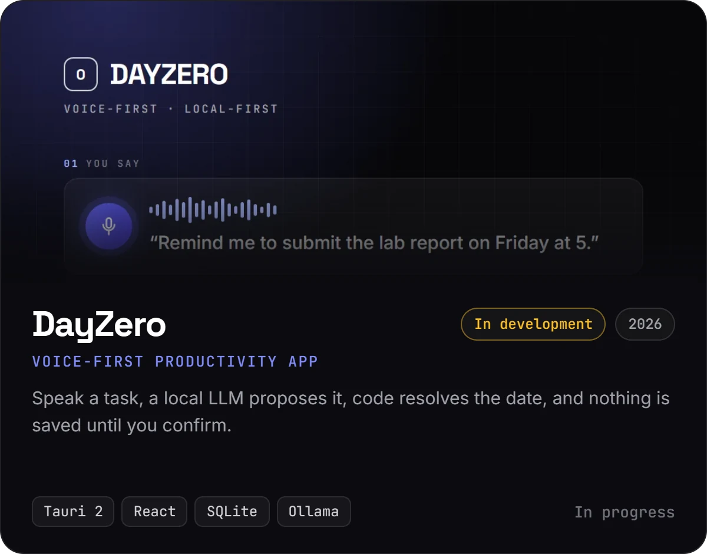

  &nbsp;
  &nbsp;
  &nbsp;
  

 

I'm a second-year CSE student at **CUSAT** in Kochi. Right now I'm teaching a model to transcribe **Malayalam legal speech**, finding manufacturing suppliers with LLM pipelines, and leading the dev team at my department's student association. Before that I shipped a packaging marketplace, a trading platform, and websites for the clubs I'm part of.

### 💼 Where I'm working

| | Role | Where | When |
|:-:|---|---|---|
| 🧠 | **Machine Learning Intern** (JurisAI) | Essbee.ae | Jul 2026 – now |
| 🔎 | **AI & Data Engineering Intern** | Aekovera | Apr 2026 – now |
| 🛠️ | **Tech Co-Lead** | ACES CUSAT | Jul 2026 – now |
| 🎨 | Frontend & UI/UX Intern | Kera.ai | Jan – Feb 2026 |
| ✏️ | UI/UX Design Intern | PHICSIT | May 2025 |

### 🌟 Things I've built

<table>
  <tr>
    <td width="50%"></td>
    <td width="50%"></td>
  </tr>
  <tr>
    <td width="50%"></td>
    <td width="50%"></td>
  </tr>
  <tr>
    <td width="50%"></td>
    <td width="50%"></td>
  </tr>
</table>

Click a card to open the live site. Code: <a href="https://github.com/Hassan-2305/aekobaba">aekobaba</a> · <a href="https://github.com/Hassan-2305/vertex">vertex</a> · <a href="https://github.com/Hassan-2305/aces-latest">aces-latest</a>. Also: <a href="https://horizoncusat.tech">Team Horizon</a> (Mars rover club site, <a href="https://github.com/Hassan-2305/horizon_webpage">code</a>) and the <a href="https://osconnect.org">Open Source Connect India</a> UI.

### 🛠 What I use

  

Also: Hugging Face Transformers · Wav2Vec2 / Whisper · neural TTS · Groq / Llama · CUDA · Zod · Vitest · C++ · Java

### 📊 Activity

  

  

